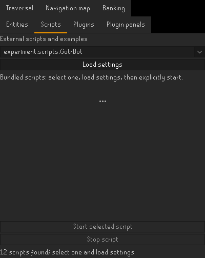
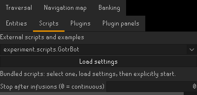
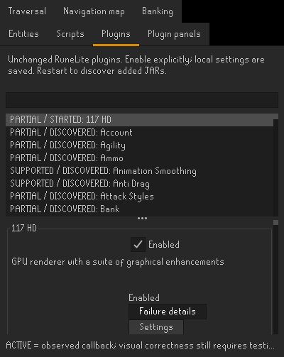
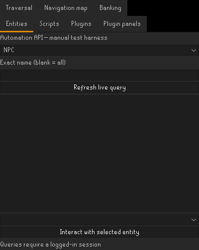

# FrankensteinLite

**A standalone OSRS client, original RuneLite plugin hosting and an extensible Java scripting platform.**

[Features](FEATURES.md) · [GOTR](docs/GOTR.md) · [Architecture](docs/ARCHITECTURE.md) · [Project status](docs/PROJECT-STATUS.md)

This repository presents the project's engineering and verified capabilities. It contains **documentation and host-interface screenshots only**. Client source, scripts, executable downloads, account information and game assets are not distributed here.

*Genuine capture of the running host's Scripts panel in an isolated, logged-out profile. No bot was started for this capture.*

## What the project does

| Area | Highlights |
| --- | --- |
| **Standalone client** | Own Windows application and canvas; portable EXE launcher, bundled Java and first-run setup implemented independently of IntelliJ and the normal RuneLite window. |
| **HD rendering** | Original 117 HD and RuneLite GPU hosted with verified native OpenGL rendering. |
| **Java scripting** | RuneLite-independent API/provider contracts, small looping scripts, configurable settings and bounded progress waits. |
| **Navigation** | Local reachability, movement beyond the loaded scene and nearest-reachable-bank selection by route cost. |
| **Game access** | Entity queries, inventory, equipment, banking, dialogue, widgets, skills, varbits, object interaction and world switching. |
| **Plugin guidance** | Typed, read-only Quest Helper, Flipping Copilot and GOTR exports with stale-state protection. |
| **Managed updates** | Separate pristine RuneLite dependency, exact-runtime compilation, compatibility checks and rollback. |

The portable launcher is implemented; a Windows installer is not. Source and binary distribution remain separate from this showcase. [Availability and limits](docs/PROJECT-STATUS.md).

## Guardians of the Rift

**GotrBot** is the framework's strongest example of responding to a changing environment. On populated multiplayer worlds, its contribution loop connects:

**Fragments → essence preparation → active altar → crafting → Great Guardian → opportunistic charged-cell use**

- Selects eligible active elemental/catalytic altars and balances personal contribution.
- Recognizes special essence portals and prioritizes them when practical.
- Fills and empties carried usable essence pouches, checking inventory changes.
- Uses charged cells opportunistically and measures the resulting contribution.
- Re-evaluates closing guardians, disappearing portals and round transitions.
- Waits for observable results and uses recurring normal canvas input during long runs.

Full unattended games and repeated contribution cycles were verified live. The owner subsequently reported consistent reward qualification after moving the **same unchanged build** to a slower world. Round duration and team conditions affect results; no universal points/hour or qualification rate is claimed.

Real GOTR settings panel

*Logged-out configuration capture. Source-path logs were excluded; the bot was not running.*

The bot relies on other players for the wider defensive game. It is not a solo solver, guardian-creation system or full barrier-repair strategy. [GOTR implementation and evidence](docs/GOTR.md).

## Script collection and Bot Hub

The host discovers scripts, exposes configuration and provides explicit start/stop controls. Enum settings become dropdowns; selecting a class does not execute it.

| Implemented script | Scope |
| --- | --- |
| **GotrBot** | Multiplayer contribution, portals, pouches and charged cells |
| **AgilityBot** | Selectable courses and reachability-based obstacles; repeated Draynor laps verified |
| **FightingBot** | Combat and looting with generic banking integration |
| **MiningBot / WoodcuttingBot** | Configurable gathering, banking and return traversal |
| **RunecraftingBot** | Basic air-rune crafting and banking using pure essence |
| **EclipseWineBot** | Collection, suitable-world hopping and two-ladder bank/return route, verified live |
| **QuestHelperBot** | Structured guidance, recommended dialogue and limited safe step execution |
| **FlippingGuidanceLogger** | Read-only Copilot recommendations; no GE offer execution |
| **Examples / diagnostics** | API checks and simple script examples |

These describe the private implementation, not downloadable scripts in this repository. Verification differs by script and course; see [FEATURES.md](FEATURES.md).

## Original RuneLite plugins

The host provides lifecycle, injection, events, client-thread execution, configuration, overlays, panels and rendering infrastructure. Original Quest Helper, official Flipping Copilot, GOTR Helper and 117 HD were hosted without modifying their JARs. Plugin enable preferences and settings persist across launches.

An isolated audit passed **133 of 134 plugin startup/shutdown checks at the login screen**. This is lifecycle coverage, not certification of every in-game branch. Configuration/Plugin Hub UI is unsupported. GPU and 117 HD retain their normal mutual conflict. [Compatibility details](docs/PLUGINS.md).

## Extensible Java API

Scripts use neutral public contracts rather than RuneLite or individual plugin implementation classes. Each loop reads current state, makes a small decision, performs an appropriate action and waits only within a bounded condition.

Actual developer query tools

*The real logged-out interface. Live query results require a logged-in session.*

[Scripting concepts](docs/SCRIPTING.md) · [Architecture and update workflow](docs/ARCHITECTURE.md)

## About this repository

There are no releases, build instructions or account-setup files here because the application is not distributed through this repository. Gameplay images and sale material were withheld while their publication scope remains unresolved. The four images above show only the host interface, without game scenes or account information.

FrankensteinLite is an independent project, with no claimed endorsement from Jagex, RuneLite or the named plugin authors. [Project and distribution status](docs/PROJECT-STATUS.md).
