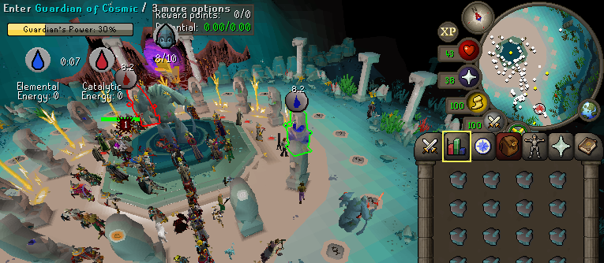

# Guardians of the Rift showcase

GotrBot demonstrates several reusable facilities working together: plugin guidance, inventory operations, traversal, queries, verified interaction progress and decisions that respond to fresh game state.

*Genuine arena capture from early development. This frame illustrates the environment and running client; it does not demonstrate the final bot's performance or reward qualification.*

## Implemented contribution loop

On populated multiplayer worlds, the bot mines fragments, prepares guardian essence at the workbench, enters eligible active altars, crafts runes, returns and infuses the Great Guardian. Charged-cell use piggybacks on the existing trip rather than forming a separate defensive strategy.

Special essence portals receive priority when practical. Carried usable pouches are filled during preparation/portal mining, emptied for altar crafting and checked through inventory changes. Guardian choice considers eligibility, elemental/catalytic balance and cell tier at natural decision points. A closing guardian triggers fresh selection; a rotation does not repeatedly interrupt productive resource work.

The original GOTR Helper supplies guardian identities/types, portal state/timing and personal energy through a neutral read-only export. Verified object/varbit fallbacks avoid reliance on rendered panel text. Recurring normal canvas input accompanies precise direct interactions in long runs.

## What was verified

- Full unattended games and repeated preparation/crafting/infusion cycles.
- Special-portal entry and resumption of the contribution loop.
- Medium-pouch Fill/Empty with observed inventory/count changes.
- Energy changes attributable to opportunistic charged-cell use.
- Sustained activity without inactivity logout in bounded sessions.
- Re-evaluation after closing guardians, portal disappearance and round transitions.

The optimized no-pouch sample recorded **262 and 302 energy**, averaging **282**. The medium-pouch sample increased the average infusion batch by **17.67%** but had substantially shorter rounds; **238 and 124** total energy do not establish a negative pouch effect. One final prepared batch missed infusion because the game ended.

The owner subsequently observed consistent reward qualification on a slower world with the **same unchanged build**. This is user-reported evidence, not a measured universal success rate. Round duration and the multiplayer environment materially affect per-round results.

## Limits

No solo solver, guardian creation, full barrier-repair strategy, combination-rune strategy, intelligent talisman strategy, automatic pouch acquisition/repair or reward claiming is implemented. The bot relies on other players for the broader defensive game.

This additional host-only capture shows the settings interface, not an executing bot:

[Back to the project](../README.md) · [Feature overview](../FEATURES.md)
